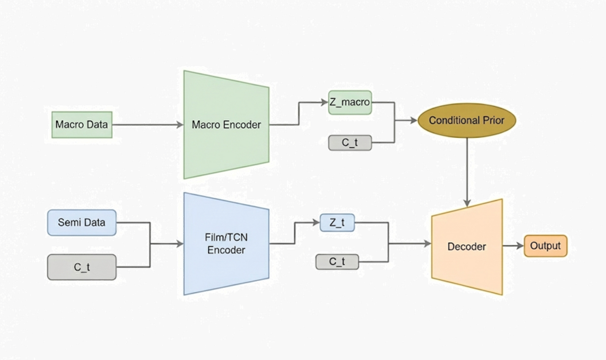
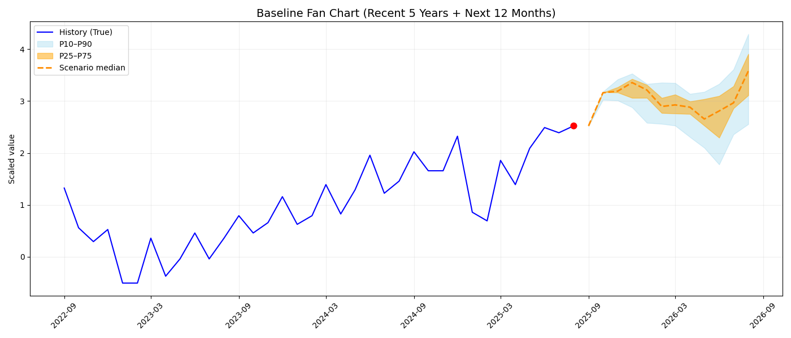
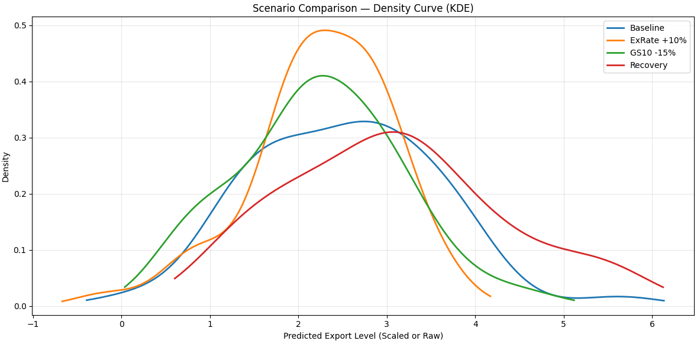

# Conditional Time-VAE for Semiconductor Cycles

**36 months of observations → 12 months of possible export paths**

[Presentation](Generative%20Scenario%20Modeling%20for%20Semiconductor%20Industry%20Cycles.pdf) · [Notebook](Timevae_final.ipynb) · [Model](model.py)

Exchange rates, interest rates, and manufacturing activity enter the model as conditions. Changing those inputs shifts the generated export distribution—and can change its downside tail even when most sampled paths still rise.

## From observations to sampled paths

We used monthly semiconductor data from January 2010 to August 2025, including exports, DRAM, exchange rates, CAPEX, PMI, CLI, and ISM. The model takes **36 months of observations and generates the following 12 months**.

There was not much data to train on at this frequency. To make use of a longer history, we first pretrained an encoder on FRED macroeconomic data starting in 1970, then connected its representations to the semiconductor model's conditional prior.

The PyTorch implementation connects a pretrained macro encoder to a conditional Time-VAE:



The temporal encoder uses TCNs with FiLM conditioning. The decoder combines **trend, seasonality, and residual components**, with a Student-t output distribution to represent large fluctuations. In the scenario experiments, we sample around the temporal encoder's latent distribution and change the economic conditions passed to the decoder.

<details>
<summary>Baseline forecast: median and quantile ranges</summary>



The orange dashed line shows the median; shaded bands show quantile ranges across generated paths. The vertical axis uses standardized values. This figure is from the original presentation.

</details>

## How the distributions compare

We compared the model with ARIMA, LSTM, and vanilla cVAE. Along with prediction error, we evaluated the forecast distributions using NLL, CRPS, and prediction interval coverage.

Here are the main comparison results reported in the presentation. Lower MSE and CRPS are better.

| Model | MSE ↓ | CRPS ↓ | 80% interval coverage |
|---|---:|---:|---:|
| CT-VAE | 0.4449 | **0.1322** | 86.19% |
| Vanilla cVAE | 0.4476 | 0.1493 | 81.58% |
| LSTM | **0.3114** | 0.1714 | 82.44% |
| ARIMA | 0.9491 | 0.7676 | 27.20% |

LSTM had the lowest point prediction error, while CT-VAE had the lowest CRPS in this comparison. Our main interest was generating possible future paths and examining their distributions. For an 80% prediction interval, coverage should be assessed against the 80% target together with the interval width.

<details>
<summary>Removing individual components: ablation results</summary>

We also removed individual components to see how the results changed. The table below keeps three measures from the ablation results: prediction error, interval coverage, and the proportion of paths with a decline greater than 10%.

| Configuration | MSE ↓ | 80% interval coverage | Paths with >10% decline |
|---|---:|---:|---:|
| Full CT-VAE | 0.1989 | 51.00% | 14% |
| Without Student-t | 0.1765 | 58.33% | 18% |
| Without Macro Prior | 0.1920 | 33.33% | 10% |
| Without FiLM | 0.1892 | 41.67% | 9% |
| Without trend/seasonality decomposition | 0.2033 | 51.00% | 22% |

Removing some components reduced the error. However, removing the macro prior or FiLM reduced interval coverage, while removing the decomposition increased the proportion of large-decline paths. The full model's 80% interval coverage was only 51% in this experiment, so uncertainty calibration still needs work. These results come from a separate experiment from the model comparison above. A smaller proportion of declining paths alone does not establish better model accuracy.

</details>

## Changing the economic conditions



*Export distributions under four economic scenarios, from the original presentation. The recovery scenario shifts the distribution toward higher export levels.*

Holding the observed history fixed, we changed the economic conditions passed to the decoder. The table follows the **final scenario summary in the presentation**, with baseline conditions from August 2025.

| Scenario | Paths with rising exports | Paths with >10% decline | Mean change in the bottom 10% (ES) |
|---|---:|---:|---:|
| Baseline | 98% | 2% | +1.1% |
| KRW/USD exchange rate +10% | 88% | 8% | -18.5% |
| U.S. 10-year Treasury yield (GS10) −15% | 80% | 14% | -18.0% |
| Economic recovery | 96% | 2% | +3.6% |

The recovery scenario combines GS10 −15%, PMI +7%, CLI +2%, ISM +5%, and KRW/USD −6%. A higher KRW/USD exchange rate worsened the downside outcomes. Lowering the Treasury yield alone did not improve the outlook either. Changing the economic indicators together improved the outcomes in the lower tail.

The rising-path proportion counts generated paths that end above the reference export level. It is not a prediction accuracy score or a probability of stock prices rising. These experiments show the model's response to changed conditions and do not establish causal effects.

<sub>The scenario values above follow the final summary slide. Some values on the individual scenario slides differ, including the rate-decrease scenario's tail probability, VaR, and ES, and some recovery scenario values. These need to be reconciled against the experiment logs.</sub>

## Reading and running the code

Start with [Timevae_final.ipynb](Timevae_final.ipynb) for the experiments, or follow the implementation through [model.py](model.py) → [main.py](main.py) → [scenario_eval.py](scenario_eval.py).

`macro_pretrain.py` trains the macroeconomic encoder; `data_train.py` handles preprocessing, windows, and training. The `baseline_*.py` scripts contain the comparison models, and `train_ablation_models.py` / `ablation_experiment.py` contain the component experiments. Monthly inputs are in `data.csv` and `macro.csv`.

<details>
<summary>Dependencies and execution notes</summary>

The main dependencies are PyTorch, NumPy, pandas, scikit-learn, SciPy, statsmodels, matplotlib, and joblib. Run from the directory containing the CSV files:

```bash
python macro_pretrain.py
python main.py
```

Paths and settings are defined inside the scripts. Check the epochs, scenario conditions, and device setting in `main.py` before running. `macro_pretrain.py` currently executes its top-level code when imported, so the execution flow still needs cleanup.

</details>

## Remaining questions

The short monthly dataset and overlapping windows limit what these results establish. Stricter time-based evaluation, the forecast origin, and consistent preprocessing for the macro encoder still need attention. GAN and diffusion baselines have not been evaluated.

